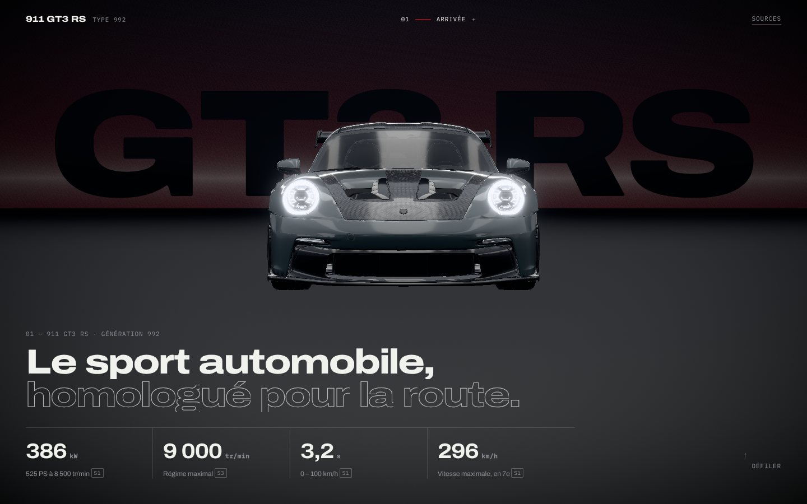
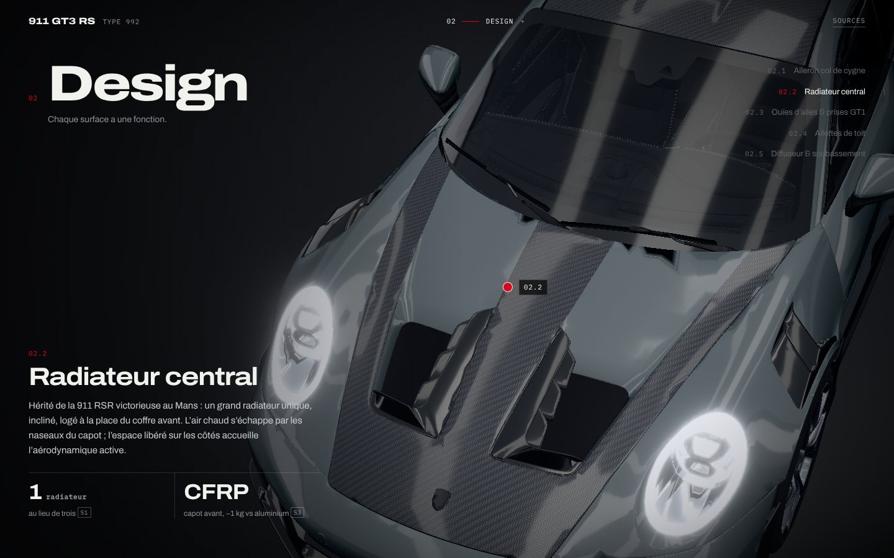
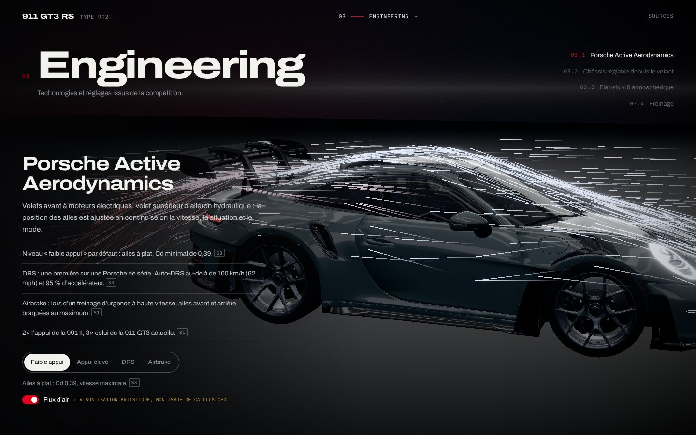
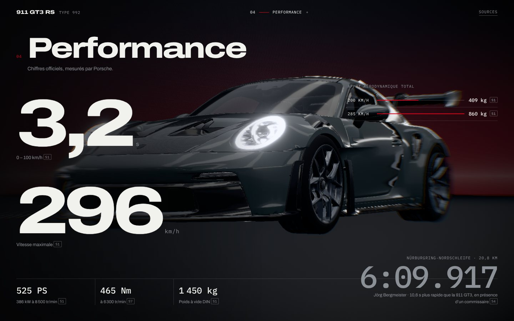
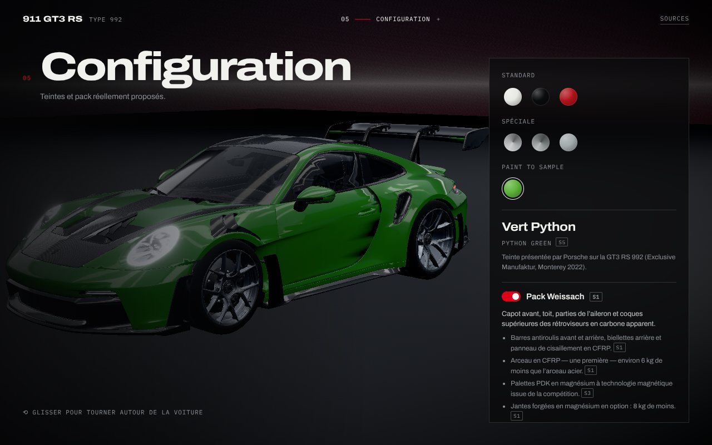
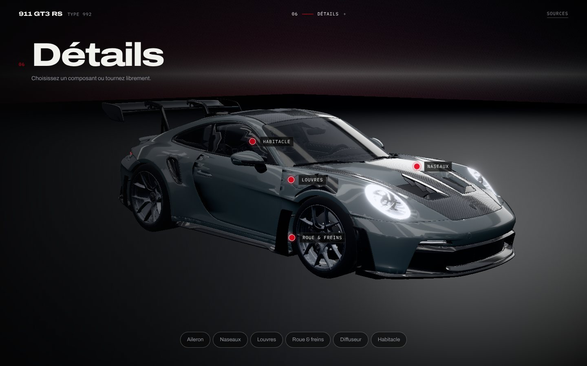
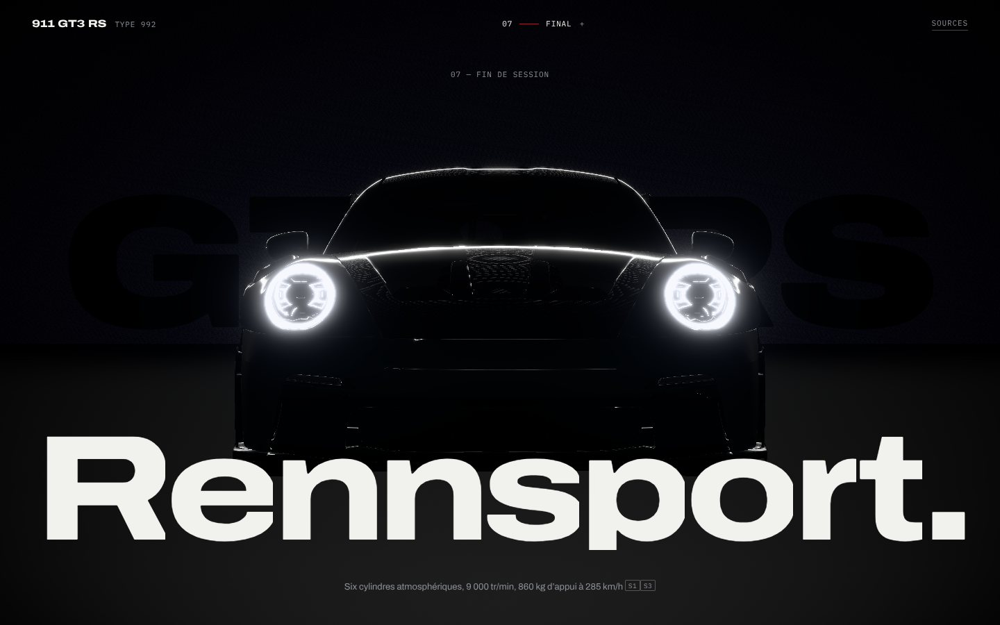
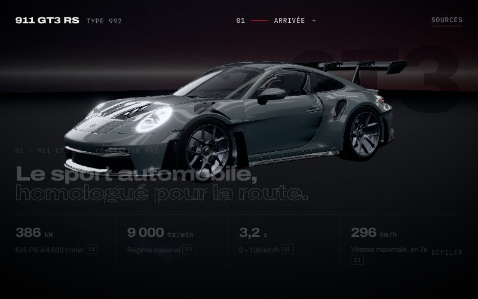

# 911 GT3 RS (992) — expérience web 3D

Étude conceptuelle **non officielle** d’un site vitrine immersif autour de la Porsche 911 GT3 RS (génération 992).
Toutes les données techniques proviennent de sources officielles Porsche (liste dans `src/data/sources.ts`
et en pied de page du site) ; tout ce qui relève de la mise en scène est signalé ✦ « interprétation artistique ».

## Lancer

```bash
npm install
npm run dev        # développement
npm run build && npm run preview
```

Le modèle 3D optimisé est versionné dans `public/models/gt3rs.glb` (4,8 Mo). Pour le régénérer depuis le GLB source :
`npm run model -- source.glb public/models/gt3rs.glb`.

## Aperçu

| | |
| --- | --- |
|  |  |
|  |  |
|  |  |
|  |  |

Mobile : `docs/captures/08-mobile.jpg`. Captures réalisées en rendu logiciel (sans GPU) : sur une vraie carte
graphique, le sol réfléchissant, le SMAA et la pleine résolution sont actifs.

## Tests

```bash
npm run build && npm run preview          # http://localhost:4173
npm run test:visual                       # captures de chaque section + métriques WebGL
npm run test:interact                     # teinte, pack Weissach, airbrake, plans rapprochés
```

`?lite` force la qualité basse (sol non réfléchissant, environnement 128 px) ; elle est aussi choisie
automatiquement sur écran tactile et quand `PerformanceMonitor` détecte une chute d'images.

## Performance mesurée

| | Avant | Après |
| --- | --- | --- |
| Modèle | 114 Mo, 1,63 M triangles | 4,8 Mo, 625 k triangles (meshopt) |
| Pièces fixes | 238 meshes | 21 meshes fusionnées par matériau |
| Appels de rendu / image (env + scène + post) | ~300 | ~125 |

## Stack

| Couche | Outils | Skill de la bibliothèque |
| --- | --- | --- |
| App | Vite + React 19 + TypeScript | `scaffold-3d-site` |
| 3D | three r187, React Three Fiber 9, drei | `react-three-fiber`, `threejs-webgl` |
| Scroll | Lenis + GSAP ScrollTrigger (source unique du scroll) | `scroll-3d-scene`, `gsap-scrolltrigger` |
| Shaders | GLSL via `onBeforeCompile` + `ShaderMaterial` | agent `shader-artist` |
| Post | @react-three/postprocessing + effet maison | `add-postprocessing` |
| Assets | gltf-transform, meshoptimizer, sharp | `optimize-3d-assets`, agent `asset-pipeline-engineer` |
| Perf | PerformanceMonitor, AdaptiveDpr, découpage du bundle | agent `webgl-perf-auditor` |
| Architecture | couches DOM / 3D / animation séparées | `web3d-integration-patterns`, `modern-web-design` |

## Architecture

```
src/
  data/        specs.ts (données vérifiées + source), paints.ts, sources.ts
  scroll/      Lenis ↔ ScrollTrigger, ancres de plans caméra, étapes de section
  three/
    shots.ts       chorégraphie : 17 plans (caméra + état de scène) interpolés au scroll
    CameraRig.tsx  amortissement, cadrage décentré (setViewOffset), orbite, plans « détail »
    Car.tsx        mise à l'échelle/orientation auto, matériaux, pivots roues & volet d'aileron
    materials.ts   peinture (vernis, paillettes, balayage de teinte, masque Weissach), carbone sergé 2x2
    Airflow.tsx    flux d'air GPU guidés par une carte de hauteurs extraite du modèle
    Studio.tsx     IBL dynamique (softbox animées), cyclorama GLSL, sol réfléchissant, traînées de vitesse
    Effects.tsx    flou radial de vitesse + aberration (effet postprocessing maison), bloom, AgX, grain
    Monumental.tsx typographie 3D métal graphite
  ui/          sections DOM, loader réel, pastilles de source
scripts/
  prepare-model.mjs  inspection + optimisation du GLB
  shoot.cjs          tests visuels Playwright (captures + métriques WebGL)
```

## Modèle 3D

« Porsche 911 GT3 RS (992) » par **DR1KING100K** — Sketchfab — licence **CC BY 4.0**
(https://sketchfab.com/3d-models/porsche-911-gt3-rs-992-70bf9c89c71442149009193233de43d5).
Le fichier source n’est pas versionné ; le GLB optimisé l’est. Les matériaux d’origine sont remplacés par des matériaux
recréés pour le projet. Il s’agit d’un modèle tiers, pas d’un fichier CAO Porsche.

## Mentions

Projet de démonstration non affilié à Dr. Ing. h.c. F. Porsche AG. « Porsche », « 911 », « GT3 RS », « Weissach »
et « PDK » sont des marques de Porsche AG. Aucun logo, aucune photographie ni aucun texte Porsche n’est reproduit.
